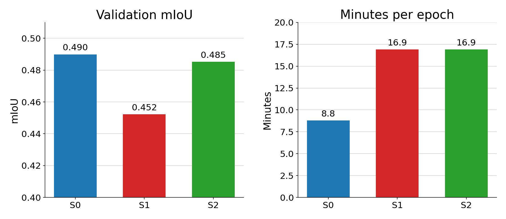
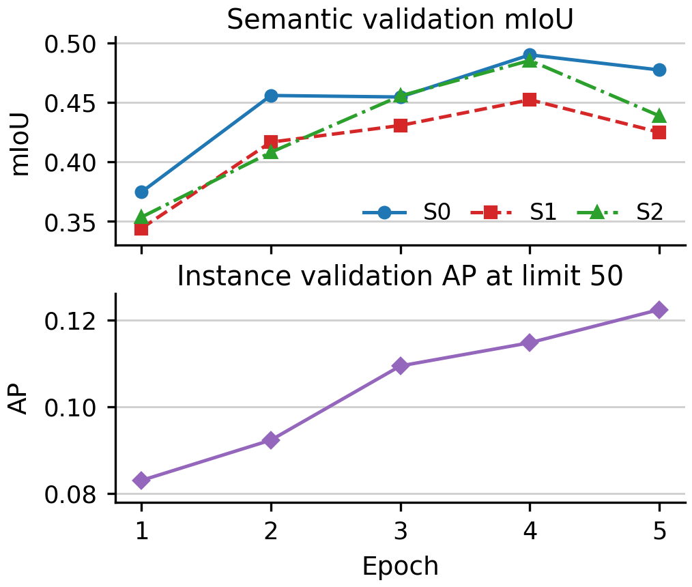

# 街景理解与图像分割 · Urban Scene Understanding

基于 **PyTorch、TorchVision 和 ResNet50** 的城市场景理解项目，包含语义分割、实例分割、模型对比、数据增强消融与误差分析，并提供可以在本机 CPU 上运行的图片分割演示。



## 功能概览

当前交互演示接入 **S0：FCN-ResNet50**，支持：

- 上传 JPG、PNG 或 WebP 街景图片，预测 19 种像素类别。
- 切换原图、彩色分割图和透明叠加图。
- 调节叠加颜色强度，在下一次预测时生效。
- 查看各类别的预测像素占比。
- 下载叠加图、彩色分割图、类别 ID 图及 JSON 统计结果。
- 使用命令行预测单张图片并保存结果，无需打开浏览器。

所有图片在本机处理，无需调用外部预测 API。已有权重时，无需重新训练，也无需下载完整 Cityscapes 数据集即可预测自己的图片。

**功能边界：**当前演示进行语义分割，不区分同类物体的独立实例，不直接提供人数或车辆计数，也未接入视频和摄像头。类别像素占比不代表预测准确率或置信度。DeepLabV3 和 Mask R-CNN 包含在实验代码中，尚未接入交互演示。

## 技术与实验设计

| 技术 | 用途 |
|---|---|
| Python、PyTorch、TorchVision | 模型构建、训练、评估及推理 |
| ResNet50 | 提取视觉特征的骨干网络 |
| FCN、DeepLabV3 | 语义分割与架构对比 |
| Mask R-CNN | 实例分割基线 |
| AdamW、水平翻转增强 | 参数优化与数据增强消融 |
| NumPy、Pandas、Matplotlib | 数据处理、实验统计和结果可视化 |
| Python HTTP 服务、HTML、CSS、JavaScript | 本地预测接口及交互界面 |

| 实验 | 模型 | 任务 | 水平翻转 |
|---|---|---|---|
| S0 | FCN-ResNet50 | 语义分割 | 是 |
| S1 | DeepLabV3-ResNet50 | 语义分割 | 是 |
| S2 | DeepLabV3-ResNet50 | 语义分割 | 否 |
| I0 | Mask R-CNN-ResNet50-FPN | 实例分割 | 是 |

语义模型使用 ImageNet 预训练骨干初始化；Mask R-CNN 使用 COCO 预训练权重，并替换框分类头和掩码预测头。已有实验采用 Cityscapes fine 数据，训练集 2,975 张、验证集 500 张，包含 19 个语义类别和 8 个实例类别。

训练配置：输入 256×512、batch size 2、AdamW、学习率 `1e-4`、weight decay `1e-4`、5 epochs、seed 9444。

## 已有实验结果

| 实验 | 验证集 mIoU | 像素准确率 | 实例 AP | AP50 |
|---|---:|---:|---:|---:|
| S0 | 0.4899 | 0.9045 | — | — |
| S1 | 0.4522 | 0.8960 | — | — |
| S2 | 0.4852 | 0.9076 | — | — |
| I0 | — | — | 0.1240 | 0.2614 |

以上为已有训练记录，**不是本次本地演示重新计算的指标**。S0 权重已在本机成功加载并完成推理，但未重跑完整验证集。验证集同时用于选模和结果报告；每种配置仅一个 seed，没有独立 test server 结果。

分析包含检测数量上限、小目标尺寸、同类物体接触情况及跨任务类别表现。完整配置与限制见[实验记录](docs/experiments.md)。



## 快速开始：本地演示

### 1. 准备模型权重

将与 S0 FCN 模型兼容的权重放到：

```text
checkpoints/S0/best.pt
```

**当前本机副本已有该文件，但 Git 仓库不包含权重。** 从 GitHub 克隆代码后，需要另行取得权重并放入上述路径；目前未提供公开下载地址。原始数据集和完整训练产物也不随仓库分发。

### 2. 准备环境

本地已验证环境为 Python 3.12、PyTorch 2.14.1、TorchVision 0.29.1，推理使用 CPU。当前开发电脑已有依赖，可以直接启动。

新环境建议使用虚拟环境：

```bash
python3 -m venv .venv
source .venv/bin/activate
python3 -m pip install -r requirements-demo.txt
```

以上激活命令适用于 macOS/Linux。训练 Notebook 的依赖与演示不同，见 `requirements.txt`。

### 3. 启动界面

在项目文件夹打开终端：

```bash
python3 app.py
```

模型加载后会自动打开 [http://127.0.0.1:8765](http://127.0.0.1:8765)。上传图片，点击“开始分割”即可。

macOS 也可双击 `启动街景.command`。若系统阻止打开脚本，使用上述终端命令即可。启动脚本默认使用 PATH 中的 `python3`，也可通过 `URBAN_SCENE_PYTHON` 指定解释器。

端口被占用时，可先检查是否已有演示在运行，或换一个端口：

```bash
python3 app.py --port 8766
```

服务只监听本机 `127.0.0.1`。在启动终端按 `Ctrl+C` 停止；关闭网页不会停止服务。

### 4. 命令行预测

```bash
python3 app.py --image /absolute/path/to/street.jpg --output outputs/my-prediction
```

| 输出文件 | 内容 |
|---|---|
| `original.png` | 经过方向校正和必要缩放的原图 |
| `segmentation.png` | 彩色语义分割图 |
| `overlay.png` | 原图与预测结果叠加图 |
| `mask.png` | 单通道类别 ID 图，值为 Cityscapes trainId 0–18 |
| `result.json` | 输出尺寸、推理耗时及各类别像素统计 |

输入先缩放至 512×256，并使用 ImageNet 均值和标准差归一化；输出 logits 经双线性插值后取最大类别。为控制内存，图片限制为 20 MB、2400 万像素，长边超过 1600 像素时等比例缩小；导出尺寸以处理后图片为准。支持 EXIF 方向校正。

浏览器下载结果保存在服务内存中，仅保留最近三次预测；服务重启或结果过期后，重新预测即可生成下载链接。详细操作见[使用说明](使用说明.md)。

## 训练与复现

1. 在 [Cityscapes](https://www.cityscapes-dataset.com/) 注册并接受数据使用条款。
2. 下载 `leftImg8bit_trainvaltest.zip` 和 `gtFine_trainvaltest.zip`，放入自己的 Google Drive，默认目录为 `MyDrive/cityscapes-archives`。
3. 在 Colab GPU runtime 打开 `project.ipynb`，安装依赖并挂载 Drive。
4. 配置 `ARCHIVE_DIR`、`DATA_ROOT`、`OUTPUT_ROOT`。对应的环境变量为 `CITYSCAPES_ARCHIVE_DIR`、`CITYSCAPES_ROOT`、`URBAN_SCENE_OUTPUT_ROOT`。
5. 将 `PROVENANCE['source_commit']` 更新为当前真实提交，设置 `RUN_TRAINING=True` 后按顺序运行。
6. 读取已完成的实验时设置 `RUN_TRAINING=False`，并提供配置和划分兼容的完整运行目录。

本地运行 Notebook 时设置 `MOUNT_DRIVE=False`，并提前配置数据和输出路径。建议使用 GPU 训练。训练依赖未完全锁定，尚未在新环境完整复现历史结果。当前只有 S0 权重，不能直接恢复其他实验的全部输出。

## 项目结构

```text
.
├── app.py                    # 本地 HTTP 服务与命令行入口
├── segmentation.py           # 模型加载、预处理、推理与类别颜色
├── web/index.html            # 图片上传、结果展示与下载界面
├── 启动街景.command          # macOS 启动脚本
├── 使用说明.md               # 中文操作说明
├── project.ipynb             # 数据、训练、评估与误差分析
├── requirements-demo.txt     # 演示依赖
├── requirements.txt          # Notebook 依赖
├── test_demo.py              # 本地服务集成检查
├── assets/                   # 已有结果图
├── docs/experiments.md       # 实验记录与限制
├── checkpoints/S0/           # 本地权重及记录，不进入 Git
└── outputs/                  # 本地预测输出，不进入 Git
```

## 验证

先启动默认端口的服务，再在另一个终端运行：

```bash
python3 test_demo.py
```

已通过四项集成检查，覆盖服务状态、真实模型推理、类别 ID 与颜色一致性、输出尺寸、像素统计、PNG/JSON 下载及错误输入。测试使用已有报告拼图，仅验证执行流程，不作为模型准确率测试。

## 数据与方法引用

模型实现与预训练权重来自 TorchVision；类别定义及官方实例评价工具来自 cityscapesScripts。Cityscapes 数据遵循其自身许可条款，本仓库不重新分发数据集。

- Cordts et al., *The Cityscapes Dataset for Semantic Urban Scene Understanding*, CVPR 2016.
- Long et al., *Fully Convolutional Networks for Semantic Segmentation*, CVPR 2015.
- Chen et al., *Rethinking Atrous Convolution for Semantic Image Segmentation*, 2017.
- He et al., *Mask R-CNN*, ICCV 2017.
